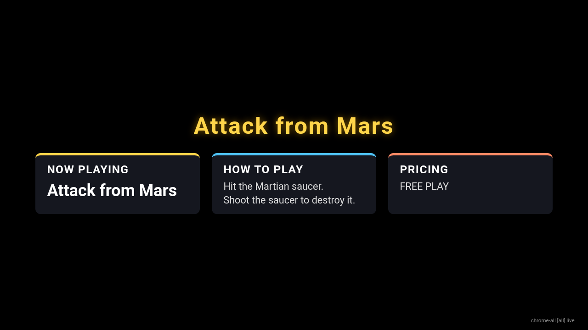

# Browser displays: TVs, photo frames, Raspberry Pi

The daemon (`host/cyd_daemon.py`) can serve now-playing content to any web browser on your network,
alongside the CYD boards. Each browser display picks a **role**, just like a CYD board, and
gets the same content a board with that role would get.




## Turn it on

In `host/config.json` (copy it from `config.example.json`):

```json
"web_hub": { "enabled": true, "port": 47321, "bind": "0.0.0.0" }
```

To try it without editing the config, run `python host/cyd_daemon.py --web-port 47321`. Use `--no-web` to turn it off.
On Windows, allow TCP 47321 inbound for Python or the exe on Private networks.

## Open a display

```
http://<cabinet PC LAN or Tailscale IP>:47321/?id=den-tv&role=picture
```

| parameter | meaning |
|---|---|
| `id` | A name for the screen, shown in `cyd_push.py --status` and `/api/clients` |
| `role` | `picture`, `pictureboxart`, `control_panel`, `howtoplay`, `videoofplay`, `gallery`, `all` (default) |
| `status=1` | Show a small link-state badge in the corner |

When nothing is playing, or at night, the page shows a clock with weather and news slides, based on the
`night` settings. In sleep mode it shows a dim clock. Click or tap the page to go full screen. The page
tries to keep the screen awake with the Wake Lock API.

## Devices

* **Smart TV browser (Samsung, LG, etc.):** open the URL and bookmark it. Old browsers fall back to long-polling on their own.
* **Fire TV / Android TV / tablet photo frame:** install *Fully Kiosk Browser*, set the Start URL to the address above,
  and turn on "Launch on boot" and "Keep screen on".
* **Raspberry Pi (any model with Chromium):** use Raspberry Pi OS with desktop, then add this to autostart:
  ```
  chromium-browser --kiosk --noerrdialogs --disable-infobars --incognito \
    "http://192.168.1.50:47321/?id=pi-hall&role=pictureboxart"
  ```
  (For example, add it to `~/.config/labwc/autostart` or as an `@chromium-browser ...` line in `~/.config/lxsession/LXDE-pi/autostart`.)
* **Chromecast / Google TV:** cast a Chrome tab with the URL. A proper Cast receiver is planned for a later phase.

## Security

The hub is read-only, and browsers can't send keys. It only answers loopback, private LAN ranges
(10/8, 172.16/12, 192.168/16) and Tailscale (100.64/10). Set `"allow": ["192.168.1.0/24"]` to narrow that.
Pictures are served only if they appear in the payload that was last published.

## Endpoints

`/` page, `/ws` WebSocket, `/api/state?id=&role=`, `/api/poll?v=N&id=&role=` (long poll, 25 s),
`/api/clients`, `/art/<key>.jpg`.
